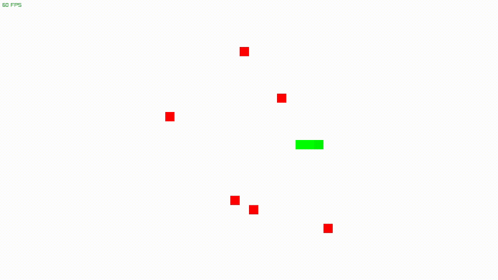
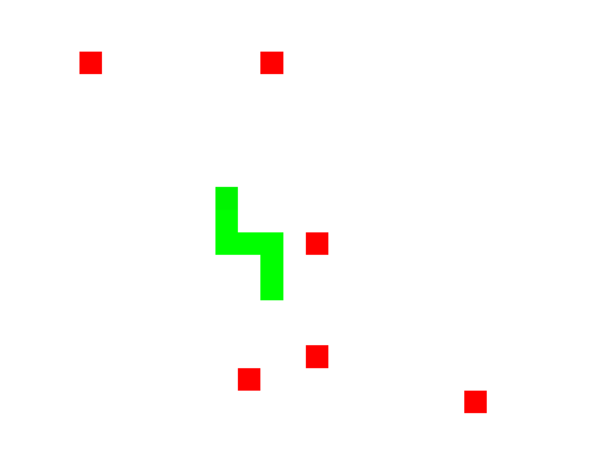

# mee

A lightweight 2D ECS game engine built on C++20 and raylib.




## Features

- ECS: components as plain structs, `view` for systems, safe entity removal during iteration
- Renderer: command batching, zIndex layers, shader-based primitives (circles, rings, tiles)
- Particles, sound, input and camera out of the box
- Pipeline: `onStart / onUpdate / onDraw` — systems as plain functions

## Quick start

```bash
git clone https://github.com/Miskyr232/mee.git
cd mee
./build.sh
./build/examples/games/snake-game/mee-snake-game
```


## Using in your own project

Once you have installed the engine using `./build.sh` (which installs it to `/usr/local` by default), you can easily use it in your own CMake projects:

```cmake
cmake_minimum_required(VERSION 3.20)
project(my_game LANGUAGES CXX)

set(CMAKE_CXX_STANDARD 20)
set(CMAKE_CXX_STANDARD_REQUIRED ON)
set(CMAKE_EXPORT_COMPILE_COMMANDS ON) # Optional: for clangd / LSP support

# Find the installed mee engine
find_package(mee CONFIG REQUIRED)

add_executable(my_game
    src/main.cpp
)

# Link the engine — include paths are handled automatically
target_link_libraries(my_game PRIVATE mee::mee)
```

A game in 20 lines

```cpp
#include "mee/mee.hpp"

int main(){
    Engine w;
    w.config.window.targetFPS = 60;
    w.init();

    w.pipeline.onDraw([](ECS& ecs, EngineResources& res){
        res.renderer.renderCircle({{100, 100}, 30.0f, Color4f::Red()});
    });

    w.run();
}
```

Examples
- snake-game — ECS snake: components, systems, signals
- langtons-ant — the classic, drawn with rects
- tree — 250k lines: a renderer stress test

Status
Experimental. The API is unstable (v0.x). Licensed under the zlib license.
